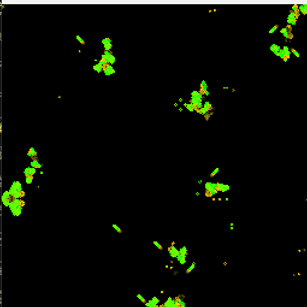

# Conway's game of life in Rust 

This project is a quick & dirty implementation of a conways game of life. The simulation is done on the gpu using shaders rather than on the cpu. It served mostly as a way to teach myself rust and the beginnings of graphics programming in rust.  

# Building & running
There are no special requirements and the project relies on `cargo` to build & run
- `cargo build` to build
- `cargo run` to run 
